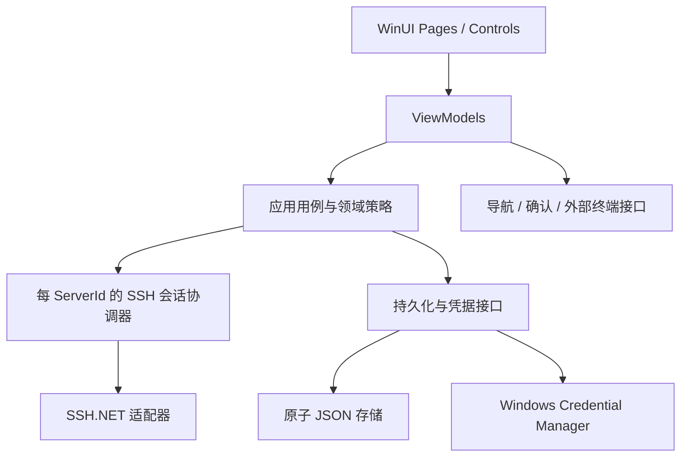

# 构建 TunnelDeck - 一个 WinUI3 的端口转发助手

> 2026-09-22 用户后续要求：M13 功能总体测试通过，继续 UI / UX 迭代；功能契约不变。UI 项目迁至 `src/TunnelDeck`，本轮视觉与交互以 [统一设计](../../docs/ui-design-system.md) 为准，检查和交付见 [UI 验证](../../docs/ui-refresh-validation.md)。保留 M13 未完成的环境验证，不自动开始新功能里程碑。

> 2026-09-21 实施更新：M0–M12 / GUI A–H 已由用户确认，继续 M13。663 项非 GUI / 真实 SSH 测试通过；有界资源列表、1000 + 1000 资源、实际 100/150/200% DPI、启动与空闲、20 条转发和本地发布已有证据。导入缩窗异常的真实消息为 “Focus cannot be moved while getting or losing focus.”，已将输入表单移出会同步重置的列表并回归；不是由 HRESULT 名称就能认定的图形设备故障。系统文字、无障碍、最终产物和人工验收继续收尾，真实状态见 [M13 验证](../../docs/m13-validation.md)、[性能](../../docs/performance.md) 和 [里程碑](../../docs/milestones.md)。内部配置 schema 2，可移植导出 v1；Local 共享、Remote 每条独立连接及仅 Local 占用时递增的边界不变。

版本：2026-09-19 规划稿。目标：在用户已创建的空白 WinUI 3 template 上，实现轻量、原生、可靠的 Windows 11 SSH 端口转发工具。

本文给出 M0–M13 共 14 个里程碑。每个里程碑都应可独立验证、交付和回退。已实施内容以上方更新和里程碑证据为准，后续步骤保留完整计划。

配套文件：[原始 77 条 UI/UX 规范](ui-ux-spec.md)、[技术核实与决策](research-and-decisions.md)、[新会话启动说明](handoff.md)。用户后续澄清优先于本文；原始规范优先于通用技能建议。

## 一、完成目标与范围

核心路径：**启动 App → 已有默认/固定 Server → 输入端口 → Enter → 看到真实运行的转发**。

完成版本需要覆盖：

1. TCP Local Forwarding (`-L`) / Remote Forwarding (`-R`)，多服务器、多条规则，每条独立启停。
2. 同端口 Quick Forward、不同端口/地址的高级编辑、仅本地监听端口占用时有限递增、Requested/Actual 分开显示。
3. 独立 Server 资源与可跨服务器的 Profile；保存配置和一键启动。
4. TitleBar 全局搜索、NavigationView working set、Pinned/Other 管理、详情页、Settings。
5. 连接认证、host key 校验、凭据存储、断线处理、正常退出清理。
6. Server 删除影响预览和一致的级联处理，Profile 删除保留 Server。
7. SSH config 有限导入、TunnelDeck 配置导入导出、外部终端入口。
8. 最近活动、可靠口径的基本统计、主题/高对比/键盘支持、可重复构建发布。

用户已确认：目前不支持远端端口失败自动递增，仅支持 Local 本地监听端口占用自动递增。其余规划默认仍为 SSH.NET 直连、密码及私钥、关闭窗口停止并退出、累计流量延期；未另行回复的选项仍是规划假设。

首版不扩展到：内置终端模拟器、SFTP、UDP、SOCKS、后台 Windows 服务、Zed 插件、自动扫描服务器端口、自动恢复上次 App 运行、完整 OpenSSH 兼容层。若澄清要求跳板机/agent/FIDO2 或流量计量，应先调整 M1，不把额外范围悄悄塞入后面的 UI 任务。

## 二、架构与必须先定下来的行为

### 2.1 工程边界

保留模板现有项目名、目标框架和打包模型；下面是逻辑结构，不要求为匹配示例强制移动所有模板文件。

```text
src/
  TunnelDeck.App/                 WinUI 入口、Pages、Controls、ViewModels、Resources
  TunnelDeck.Core/                Models、校验、策略、用例、接口；不引用 WinUI/SSH.NET
  TunnelDeck.Infrastructure/      SSH.NET、JSON、Credential Manager、Terminal 适配
tests/
  TunnelDeck.Core.Tests/          纯逻辑与用例；假时钟、假连接、故障注入
  TunnelDeck.Infrastructure.Tests/文件/Windows 凭据/进程参数集成测试
  TunnelDeck.Ssh.Tests/           受控 sshd 上的真实数据链路与故障测试
test-infra/                      编译型测试辅助程序（TunnelDeck.ProcessProbe）
scripts/fixtures/                sshd fixtures、启动/清理脚本、echo 服务
docs/                           规范、ADR、里程碑状态、人工验收记录
.codex/history/                  每次较大改动的目的、模块、验证和限制
```

小项目只需要这些边界，不引入通用 Repository 框架、事件总线、CQRS、数据库或 Generic Host。可先在单项目中按目录划分，再把需要脱离 WinUI 测试的 Core 抽出。

依赖：模板的 Windows App SDK；`SSH.NET`；`CommunityToolkit.Mvvm`。JSON 使用 `System.Text.Json`。托盘确定需要时才引入 `H.NotifyIcon.WinUI`。测试选择一个 xUnit/MSTest/NUnit 体系，尊重模板现有习惯，锁定版本。



Pages 只处理视图生命周期、focus、flyout/dialog anchor 等 UI 事项；删除扫描、端口分配、重连不能写在 Page code-behind。后台操作通过 DispatcherQueue 更新 UI，不能在后台线程修改 UI 集合。

### 2.2 数据契约

| 模型 | 最少字段与约束 |
| --- | --- |
| RemoteServer | `Id: Guid`、DisplayName?、Host、Port、Username、AuthMethod、IdentityFilePath?、CredentialReference?、LastUsedAt?；DisplayName 允许空和重名 |
| ForwardProfile | Id、Name、按顺序保存的 Rules、LastUsedAt?；不绑定一个 Server |
| ForwardRule | Id、ServerId、Mode、LocalHost、LocalPort、RemoteHost、RemotePort、AutoFindAvailablePort；端口为 1–65535；自动搜索仅 Local 生效，Remote 保存为 false |
| AppSettings | SidebarMaximumItems=5（3–10）、DefaultServerId?、AutoFindAvailablePortDefault（仅新建 Local 使用）、PinnedQuickServerId?、DefaultAuthenticationMethod=Password、DefaultIdentityFilePath?；默认认证仅预填新 Server 与无显式认证的 SSH config 条目 |
| ResourceOrder | PinnedProfileIds、OtherProfileIds、PinnedServerIds、OtherServerIds；数组顺序即 UI 顺序 |
| ActiveTunnel | Id、ServerId、Mode、Requested/Actual 双端地址端口、状态、StartedAt、EndedAt、最近连接时间、来源快照、最后错误；运行时对象不序列化到配置 |
| ActivityEntry / UsageStatistics | 成功/失败/停止的历史快照、UTC 时间；累计成功启动次数与 per-resource 使用次数独立于裁剪后的 Recent 列表 |
| TrustedHostKey | 规范化 host + SSH port + 算法 + 公钥/指纹；与显示名无关，不通过导入配置自动授信 |
| AppState | SchemaVersion、Revision、资源、顺序、设置、历史/计数；无明文密码、私钥内容、SshClient 或 Socket |

`LocalHost/RemoteHost` 的角色取决于模式：

| 模式 | 监听地址 | 目标地址 | 自动搜索改变哪端 |
| --- | --- | --- | --- |
| Local `-L` | 本机 LocalHost:LocalPort | SSH 服务器视角的 RemoteHost:RemotePort | 仅 LocalPort |
| Remote `-R` | SSH 服务器上的 RemoteHost:RemotePort | 本机视角的 LocalHost:LocalPort | 不支持自动递增，失败即返回错误 |

默认地址明确使用 `127.0.0.1`，不要依赖 `localhost` 在 IPv4/IPv6 上的解析差异。高级 bind 字段按所选后端的实际支持范围验证；不要把 SSH 服务器地址与转发目标地址混为一谈。`-R` 真实访问方向为 Remote → Local，UI 的方向说明必须正确，不能把两个模式画成相同的数据流向。

所有 Profile 启动都复制配置快照。更改/删除 Profile 或 Rule 不自动更改已经运行的隧道；来源名称保留快照，已删除的来源不再提供导航入口。删除 Server 则强制清理引用它的规则与隧道。

### 2.3 生命周期与并发契约

```text
Starting → Running → Stopping → Stopped
Starting → Failed / Cancelled
Running → Reconnecting → Running / Failed
任何非终态 → StopRequested → 停止并禁止复活
```

- `Active` 在 UI 中表示 Running；Sidebar 的 N active 只统计 Running，不把 Reconnecting 当已建立。
- 每个 ServerId 一个逻辑协调器；Local 规则共享 Local-only 物理 session，Remote 每条独立物理 session。无活动/待恢复规则时释放。连接参数变化前先停止该服务器相关操作。
- 每台服务器的控制操作串行；跨服务器有并发上限，例如 4。UI 事件订阅有明确释放点。
- `StopAsync` 幂等，重复 Enter/双击不能并发创建重复转发；重连、删除、退出通过状态/代次标记阻止迟到回调恢复已停止规则。
- 基于 Mode + ServerId + requested endpoints 的完全重复请求返回现有条目；部分重叠或目标不同的规则按照真实绑定结果处理。自动调整后也不能用 Actual endpoint 误判为新的请求。
- 相同规则通过多个 Profile 出现时复用已运行条目；来源表示首次创建者，批量结果报告“already running”。规则级 Stop 就是停止该隧道，不建立隐含的多 Profile 引用计数。
- Profile Start all 逐条报告 Started / AlreadyRunning / Failed / Cancelled；部分成功保持运行，可重试失败条。
- 监听成功与目标健康分开：记录库实际通知的连接请求失败，不随意销毁 listener。SSH.NET 2026.0.0 的 Local direct-tcpip OpenFailed 没有完整透传到公共异常事件，不能保证每次 Local 目标拒绝都有应用诊断；客户端 EOF 不当作端口占用。

### 2.4 端口搜索契约

先真正申请 N；仅 Local 模式、启用自动搜索且本地绑定失败为 AddressAlreadyInUse 时，按 N+1、N+2……递增 LocalPort。最多 20 次申请（含 N），同时有总时限、单次超时及 CancellationToken；使用整数防溢出，到 65535 即停止。目标地址端口与配置的 Requested 均不变。

Windows AccessDenied/保留端口、认证、host key、DNS/网络错误、超时及取消均不触发端口递增。`-R` 始终只申请指定端口一次；失败返回通用错误，由用户编辑端口或服务端策略后手动重试。即使旧配置或草稿错误地携带自动搜索标志，Remote 也不能进入递增路径。

每次失败释放临时 ForwardedPort、事件和注册。远端超时是结果未知，使该规则的独立 session 失效；禁止复用它继续发请求造成晚到的回复串扰。

### 2.5 全局交付规则

- 每层交付：代码、必要测试、测试结果、可运行入口、已知限制、对应 `.codex/history/*.md`。
- `dotnet build` 成功不等于 GUI 验收成功；UI 改动须实际启动，确认顶层窗口响应和预期内容。
- 纯逻辑/文件/网络测试由 Agent 编写执行；不把 SSH 故障、删除一致性和序列化正确性丢给用户手测。
- GUI 人工验收分别记为“待评测/通过/需修改”，不能因用户尚未回复就填写“通过”。可继续无依赖的测试或底层工作。
- GUI 使用测试数据模式时必须显式区分，独立数据目录，不显示伪造的“真实连接成功”。
- 先修该层失败再扩大范围。真实 SSH 测试缺少受控环境时明确标记 Blocked，不用 mock 全绿替代。

## 三、里程碑路线图

| 层 | 目标 | 依赖 | 用户参与 |
| --- | --- | --- | --- |
| M0 | 模板、工具链与验证基线 | 无 | 仅在实际项目位置未知时提供路径 |
| M1 | SSH/WinUI 关键风险验证 | M0 | 产品语义澄清 |
| M2 | 领域模型与可测试策略 | M1 | 无 |
| M3 | 配置、凭据与原子持久化 | M2 | 无 |
| M4 | 原生 Shell、导航与视觉骨架 | M0、M2 | GUI 评测 A |
| M5 | Server 编辑、认证与连接管理 | M3、M4 | GUI 评测 B |
| M6 | 多规则转发引擎与端口分配 | M1、M2、M5 | 无 |
| M7 | Quick Forward / Active Tunnels 实用闭环 | M4–M6 | GUI 评测 C |
| M8 | Profiles、资源管理与 working set | M3、M7 | GUI 评测 D |
| M9 | 删除影响与业务一致性 | M6、M8 | GUI 评测 E |
| M10 | 重连、退出与运行稳定性 | M7、M9 | 仅关闭体验评测 |
| M11 | 导入导出、Open Terminal | M3、M5、M8、M9 | 导入预览评测 |
| M12 | Recent、Statistics、Settings 完成 | M7–M11 | 低优先级区域评测 |
| M13 | 综合验收、性能与发布 | M0–M12 | 最终 GUI 评测 |

**M7 是第一个日常可用版本，M10 是稳定使用候选，M13 才是完整首版完成点。** M4 可以在 M3 的独立存储工作之外推进，但实施时不要求启用多个 Agent。

## M0：模板、工具链与验证基线

**目标**：确认现有 template 能构建、真实启动，并建立可以重复运行的工程和测试入口。

**实施**：

1. 在实际项目读取 AGENTS.md、`.sln/.slnx`、`.csproj`、manifest、现有包引用；记录 .NET SDK、Windows SDK、Windows App SDK、架构、packaged/unpackaged。
2. 保留模板启动模型，首次 build/run 不做 UI 重构；锁定 SDK 与 NuGet，启用 nullable、基本格式和命名规范。
3. 建立测试项目与应用服务的注入入口，不为样板 getter/setter 编写无价值测试。
4. 明确 test data 路径，测试不得触及真实 `%LocalAppData%` 数据或 SSH 配置。
5. 探测可用的 Docker/WSL/隔离 sshd fixture 环境。选择一条受控环境路径，固定 sshd 镜像/版本；另设可拒绝转发和可替换 host key 的实例。编写启动/就绪/清理流程。
6. 写 `docs/baseline.md`：实际 build/run/test 命令、打包模型、环境限制。对安装或升级需求先列缺项，不因规划而盲目更新整套工具链。

记录 Release 模板的启动、空闲 CPU/内存/句柄基线，供 M13 在同机比较；当前没有 App 性能实测值。

**Agent 测试**：干净 restore/build；运行模板并确认响应窗口；测试 fixture 能接收 echo 请求；清理后无测试进程、监听或容器残留。

**通过标准**：另一轮会话按文档能复现；真实 SSH 测试环境已就绪。若夹具环境受阻，可单独记录“模板基线通过”，M0 整体仍未通过，M1 的真实链路验证仍待完成。没有 GUI 风格评测需求。

## M1：关键风险验证与行为决策

**目标**：以很小的实验确认后端能力，避免界面完成后才发现需求无法兑现。

**实施**：

1. 用固定版本 SSH.NET 验证：同一连接 2 条 `-L`、2 条 `-R`，逐条停止；API 的实际错误类型、取消/超时和 Dispose 行为。
2. 比较远端端口被占用、`AllowTcpForwarding` 禁止、PermitListen 限制的响应；记录原因不确定性，并验证 Remote 失败不会自动递增。
3. 验证 `-R` 接收/取消监听、目标地址解析、loopback 和 IPv6 支持边界；明确不支持值的 UI 校验。
4. 验证未知/变更 host key 拒绝路径、加密私钥口令、Windows 凭据读写路径。
5. 最小 WinUI 实验：原生 TitleBar 搜索与 pane toggle；固定 Sidebar 顶/底和中间滚动；关闭事件异步清理。验证目标 SDK 的可用 API，不大规模编写页面。
6. 固化 ADR：远端重试语义、关闭行为、批量部分成功、重复启动、Profile 运行快照、SSH 范围、统计口径。未回复的可调整产品选项保留为规划默认。

**Agent 测试**：

- `SSH-01`：真实 payload 通过四条隧道，停止其中一条后其他三条仍能传输。
- `SSH-02`：占用监听端口可复现失败，关闭原服务后可使用该端口。
- `SSH-03`：服务端禁止转发与端口占用的失败证据归档；不编造区别。
- `SSH-04`：远端请求超时后的迟到结果不能被下一条操作认领。
- `AUTH-01`：未信任/变更 host key 时绝不进入允许的认证连接。

**通过标准**：形成可重跑的实验与事实清单；M6 所需关键 API/语义成立。控制回复隔离须经过实测；Remote 自动搜索已按用户要求移出当前范围。

## M2：领域模型与纯逻辑策略

**目标**：无需启动 WinUI 或 sshd 就能验证主要业务规则。

**实施**：

1. 实现上述数据模型与校验器；区分配置、运行快照、历史快照和 UI 草稿。
2. 提取 `PortSearchPolicy`、`ResourceOrderService`、`SidebarProjection`、`RuleDefaultsResolver`、`DuplicateTunnelPolicy`。
3. 定义小接口：`ISshSessionFactory`、`IForwardHandle`、`IStateStore`、`ICredentialStore`、`IHostKeyStore`、`ITerminalLauncher`；按测试接缝设计，避免每个类都加接口。
4. 用 `TimeProvider`/可替换时钟、随机源、延迟提供器控制时间相关测试。
5. 错误分类至少区分输入、凭据、host key、连通性、监听冲突、远端拒绝、超时未知结果、取消、存储错误。
6. 新 Rule 默认 Server：上一条 Rule → Quick 当前选择/固定 → Settings.DefaultServer → null；每次校验 Server 仍存在。

**Agent 测试**：

- `DOM-01`：Local/Remote 的监听端和目标端映射正确；仅 Local 模式的 LocalPort 可递增；Remote 无论标志或错误类型都不能递增；0、负数、小数、65536 非法。
- `DOM-02`：20 次上限包含首个端口；65535 不溢出；非冲突错误不推进候选。
- `ORDER-01`：新增/Unpin 到 Other[0]，Pin 到 Pinned 尾部，只有 Pinned 可 reorder。
- `ORDER-02`：Sidebar 先取 Pinned、Recent 补齐去重；分别验证 3/5/10 上限、空数据、Pinned 超上限和 LastUsedAt 相同。
- `ORDER-03`：访问、成功转发、更新 LastUsedAt 均不重排 Other。
- `DEFAULT-01`：逐一覆盖默认服务器四级优先级、已删除服务器、空 Profile。
- `DOM-03`：DisplayName 重名不串数据；重复请求幂等；Profile 快照不随配置修改。

**通过标准**：上述政策有行为测试；Core 不引用 WinUI/SSH.NET，模型序列化不包含运行资源。用户无需手测。

## M3：配置、凭据与原子持久化

**目标**：资源、顺序、设置能够可靠保存，写入失败不会损坏已有数据。

**实施状态（2026-09-19）**：完成，Core / Infrastructure 合计 214 项测试通过，原生窗口错误恢复与关闭 smoke 通过。格式为首个持久化 schema 1；迁移入口通过独立旧格式夹具验证，生产未臆造不存在的旧版格式。加载只修复顺序 ID 和失效默认选择，未知格式只读且不回退旧备份；凭据补偿队列持久化并受跨实例配置锁保护。详情与测试边界见 [存储契约](../../docs/storage.md)。

**实施**：

1. `AppState` 使用版本化 JSON；数据目录通过一个服务选择，按实际打包模式确认，禁止写安装目录。
2. 单写入队列，同目录临时文件 → flush → replace/rename，保留可恢复备份；首次创建和已有文件替换分别处理。
3. 配置编辑先生成候选快照，持久化成功才发布到内存 UI；Pin/排序等即时操作也通过同一提交机制。
4. 加载校验：缺失引用、重复 ID、未知枚举/版本、非法端口、Pinned/Other 重复及遗漏。安全可修复项记录诊断；未知未来版本禁止覆盖。
5. Credential Manager 独立存储密码/私钥口令；JSON 仅引用。私钥文件默认只引用路径。写入新凭据先分配新引用，配置提交失败清理新凭据；成功后再删除旧引用。
6. 信任库与配置导入分开。正常编辑即持久化，不只在关闭时保存；最近活动可批量/debounce，退出时 flush。

**Agent 测试**：

- `STORE-01`：全部字段及四个顺序数组 round-trip；ActiveTunnel/秘密不进入 JSON。
- `STORE-02`：在临时写入、flush、替换各阶段注入异常；磁盘始终保留完整旧版或新版，不能得到半个文件。
- `STORE-03`：损坏主文件、有效备份、二者都损坏、未知 schema、迁移重跑；不可静默重置用户数据。
- `STORE-04`：连续并发提交、失败重试、保存期间关闭不会丢失较新的 revision。
- `CRED-01`：独立测试凭据读写删、取消记住、替换失败补偿；日志和导出中不出现测试密码。

**通过标准**：文件故障由自动化测试证明可恢复；下次启动恢复顺序/默认值，活动隧道列表为空；错误通过可处理结果返回 UI。用户无需手测。

## M4：App Shell、导航与视觉骨架

**目标**：先验证原生 Windows 风格与信息布局，避免完成业务后大面积返工。

**实施状态（2026-09-19）**：六类页面、导航 / 搜索 / Back、隔离 Sample / Stress / Empty 数据、响应式布局已实现。229 项 Core / Infrastructure 测试通过；三套原生窗口脚本通过。为避免无效按钮，提前接入 M3 已支持的基本元数据保存、Pin / 菜单移动和设置。用户回复「OK，继续 M5.」，据此记录 GUI 评测 A 已确认。Agent 未切换系统 High Contrast；这项操作不作为已实测证据。详见 [页面契约](../../docs/shell-and-navigation.md)。

**实施**：

1. 实现 `AppShell = TitleBar + NavigationView + Frame`，以及 Dashboard、Profiles、ProfileDetail、Servers、ServerDetail、Settings 六类页面。Add/Edit 复用 Detail。
2. TitleBar 使用 Tall 高度、左侧 hamburger 与 TunnelDeck 标题、右侧 AutoSuggestBox；暂不显示 App Icon，保留拖动区、系统 caption 区与 Snap 行为。
3. pane toggle 只操纵 NavigationView 的 `IsPaneOpen`。固定 Dashboard 与 footer；两个静态 Profiles/Servers header，只有中间资源区统一滚动；All 入口始终存在。
4. 在 M1 已验证的原生插槽/组合上实现固定区域。如果目标 SDK 必须调整模板才能满足，记录最小差异，不偷偷放弃固定 footer，也不重写整套导航控件。
5. Mica + ThemeResource + 系统文字样式；间距限于规范尺度，页面 padding 24，窄窗 12–16。InfoBar/Flyout/ContentDialog 各司其职。
6. 使用有代表性的独立设计数据：空集合、大量 pinned、超长中英文名称、相同名称、长 IPv6。演示状态不调用真实网络。
7. 全局搜索先用纯函数检索 Profiles 名称和 Servers 名称/host/user；返回资源类型和 ID，重名可区分。搜索选择和 Back 不重复压入相同页面。
8. 框架初版支持宽/中/窄布局；提前决定各区域滚动所有者，避免整个 Sidebar 一起滚动。

**Agent 测试**：build + 实际启动；导航路由/搜索排序与命中/空结果单测；确认 AutomationId 和图标按钮 Accessible Name；检查无占位颜色、假按钮和 caption 遮挡。Agent 有原生 UI 工具时进行 smoke 操作，缺少时准确标注可验证范围。

**人工评测 A（用户）**：

- 1100–1300 epx 下层次符合 Quick Forward > Active Tunnels > Recent/Statistics；没有大卡片堆叠。
- 约 900、640 epx 宽度以及约 600 epx 高度下，导航折叠合理，中部资源滚动时 Dashboard/Settings/状态仍可达。
- 搜索、窗口拖动、最大化/还原、关闭区域不相互干扰；只有一个有效 hamburger。
- Light/Dark/High Contrast 无不可读内容；Mica 不被无意义不透明根背景覆盖。

**通过标准**：上述布局得到用户确认；反馈记录为截图/文字对应的具体问题。没有实测不得写“视觉已验收”。

## M5：Remote Server 编辑、认证与连接管理

**目标**：能够保存真实服务器并可靠验证连接，为转发引擎提供 session。

**实施状态（2026-09-20 更新）**：已完成密码 / 未加密及加密私钥、可选凭据保存、原生指纹确认队列、临时 Test Connection、引用释放与关闭清理、服务器身份占用门禁。M5 阶段 298 项测试通过（Core 184、Infrastructure 79、真实 SSH 35）；连接表单和三套既有原生窗口回归通过。GUI 评测 B 已由用户「GUI 人工评测通过，继续 M6.」确认，详见 [连接契约](../../docs/connections.md) 与 [M5 历史证据](../../docs/evidence/2026-09-19-m5.json)。

**实施**：

1. 完成 Server Detail 的 DisplayName、Host/IP、Username、SSH Port、Authentication Method；Password 与 Private Key/Identity File 两种表单，支持加密私钥口令。
2. 显式 Save/Cancel 与字段校验；DisplayName 为空回退 Host，允许重名；新增成功插入 Other[0]。
3. `SshConnectionManager` 按 ServerId 协调 session，连接超时、取消、keepalive、事件退订和引用释放。Local 并发请求共用一次连接建立流程；Remote 每条独立传输。临时 Test Connection 使用独立连接，成功后关闭，不生成 ActiveTunnel，也不复用已有连接来代替验证表单中的凭据。
4. host key 首连确认与变更拒绝；确认 UI 使用统一队列，不能同时叠多个 ContentDialog。用户交互等待期间不占用业务锁；确认后重连仍验证指纹。
5. 界面明确区分 auth method 与 fingerprint。可选记住密码/口令，缺失凭据内联请求，禁止日志输出。
6. 有活动/待重连规则、正在连接或等待指纹确认的工作时，只允许直接编辑 DisplayName；修改 Host/Port/User/Auth/凭据要先停止该 Server 的工作。身份检查与保存提交共用登记门禁，防止连接在检查后、落盘前使用旧身份。
7. Server 列表显示名称和 endpoint，连接错误可重试；Open Terminal 入口保留到 M11 完成时再启用，不能假装已工作。

**Agent 测试**：

- `AUTH-02`：密码、无口令私钥、有口令私钥成功；错误密码、错误口令、不可读文件分别失败。
- `AUTH-03`：首次信任拒绝/接受、已保存 key 重连、key 改变、确认后握手 key 再改变。
- `CONN-01`：同 Server 的 Local 并发请求只发起一次连接建立流程（拒绝未知指纹的探测握手 + 受信任的认证握手）；Remote 按 ADR 独立；两个 Server 独立；Test Connection 不遗留空闲连接。
- `CONN-02`：DNS 失败、超时、取消、关闭期间回调到达均有确定结果，UI 不阻塞。
- `CONN-03`：连接身份修改受活动状态约束；显示名修改不重建连接。

**人工评测 B（用户）**：表单紧凑、错误靠近字段、凭据输入清楚；指纹确认能说明服务器和操作；Test Connection 等待时窗口可操作；返回页面不丢失明确保存的数据。

**通过标准**：认证和连接边界由真实 sshd 测试覆盖，用户只评估表单体验。不能用 `CanTrust = true` 绕过未完成的信任 UI。

## M6：多规则转发引擎与端口分配

**实施状态（2026-09-20）**：已完成。`Core/Tunnels/TunnelManager` 与 `AppServices.Tunnels` 就位；真实 Local / Remote echo、HTTP、1 MiB 和并发客户端、端口分配、持有确认回复时的取消 / Remove / Shutdown 均通过。生命周期与错误观测边界见 [tunnels](../../docs/tunnels.md)。M6 无新增人工 GUI 关卡。

**目标**：实现可脱离 WinUI 运行的 `TunnelManager`，完成核心 SSH 行为。

**实施**：

1. 对 `ForwardedPortLocal` / `ForwardedPortRemote` 封装生命周期句柄；按模式把数据模型映射到 bound/target。
2. 按服务器串行调度 Start/Stop/Dispose；实例在整个操作生命周期中保持明确归属。失败 candidate 必须移除并 Dispose。
3. 实现仅针对 Local 监听占用的有限顺序 allocator，保持 Requested，写入 Actual 与 AdjustmentReason。Remote 只申请一次，不递增。避免先探测再绑定和修改目标端口。
4. 实现重复请求幂等、每条独立 Stop、Start all/Stop all 的逐条结果与并发限流。
5. 将实际观察到的目标连接失败与 listener 失败分开；适度聚合重复错误，避免每个 TCP 请求弹一条 InfoBar。活动快照有单调版本，乱序通知不能使计数倒退。Local 目标拒绝事件不完整是已验证的库限制，不伪造错误或健康结果。
6. 将远端监听请求“明确拒绝”和“超时/结果未知”分开。未知时失效该 session 并更新所有相关状态，防止遗漏监听或回复串扰。
7. 从第一次接入真实转发开始就提供基本 Shutdown：阻止新建、停止句柄、Dispose session。不能等 M10 才清理真实资源。

同步 `ForwardedPort.Start/Stop` 放到受控后台执行。取消包装 Task 或 `WaitAsync` 超时不会自动取消底层调用：必须继续追踪其完成、处理迟到结果，必要时终止其所属 session。不能把仍在运行的工作线程和句柄丢掉后直接报告清理完成。

**Agent 测试**：

- `TUN-01`：真实 `-L`、`-R` echo/HTTP payload 双向一致，包含较大 payload 和同时多个连接。
- `TUN-02`：Local 的 N 被占用选 N+1；连续占用选最小可用候选；自动搜索关闭或 Remote 模式时只申请一次。
- `TUN-03`：搜索耗尽、65535 边界、取消、AccessDenied、认证失败、远端策略拒绝均符合政策；远端错误文案不武断写占用。
- `TUN-04`：相同请求双击/并发提交只有一条；不同 Server 的本地监听端口仍由本机全局绑定竞争决定。
- `TUN-05`：同连接多条规则中停止一条，其他规则继续传输；停止后重新绑定原端口成功。
- `TUN-06`：Start 与 Stop/删除/关闭交错，迟到成功不会产生 orphan tunnel；所有临时事件/句柄释放。
- `TUN-07`：监听成功、目标服务未启动时，记录可观察到的连接请求错误并保留 listener；两种模式均验证目标启动后可继续传输。Local 以客户端 EOF 和后续 payload 证明状态，明确保留异常事件不完整的限制；Remote 独立断言请求诊断，不假定客户端立即收到 EOF。
- `TUN-08`：正常退出后本地和远端监听释放；每条真实测试在 finally 中清理。

**通过标准**：纯单测与真实 SSH 集成测试同时通过，不能只断言 IsStarted。用户无需手测网络正确性。

## M7：Quick Forward 与 Active Tunnels 闭环

**目标**：交付第一版可供日常使用的核心界面。

**实施状态（2026-09-20）**：Quick Forward / Enter / 高级端点、临时凭据、稳定活动行、独立 Stop / Retry / Remove、调整与 Details Flyout 已接入。VM-01–04 与真实原生转发闭环通过，GUI C 已由「GUI 通过，继续 M8.」确认。M7 提前接入最小离散活动记录，M8 补充 Profile 使用；重连统计仍留给后续里程碑。契约与证据见 [quick-forward](../../docs/quick-forward.md)。

**实施**：

1. Dashboard 顶部 Quick Forward：Server selector、Local/Remote 人类可读模式名、端口输入、仅 Local 可用的自动找本地端口、Forward；Remote 隐藏该选项并提示失败需手动调整；Secondary 区域预留实际 Open Terminal。
2. 默认单端口输入映射双方同端口；展开高级项编辑不同端口及地址。Quick 当前选择跨页面保留，固定选择跨重启保存。
3. Server 已选时端口输入 Enter 直接启动；NumberBox 在提交时校验原始文本/整数范围，防 NaN、小数及旧值未提交。重复提交受命令 busy 和引擎幂等双重约束。
4. Active Tunnels 使用紧凑 ListView，展示 Server、mode、两端实际端口、状态、Stop/More；Starting/Reconnecting 等条目可见但不计入 N active。
5. 自动调整标识仅出现在 Local 模式变化的本地监听端口旁：Attention IconInfoBadge + 可聚焦 Button + ToolTip/Flyout；Remote 不显示自动调整标识。不要用数字 badge 包住端口或把整行改为 Warning。
6. Details Flyout 显示 Requested/Actual、开始时间、动态 duration、来源快照；打开时更新 duration，关闭后停止无用 tick，不写磁盘。
7. 失败条保留到用户重试/移除，正常停止条进入 Recent；成功直接反映列表，不反复弹成功 InfoBar。
8. 无 Server 时提示 Add server，无运行隧道时简洁空态；保留输入与合理 focus，新增多条端口无需反复选 Server。
9. 保存 Started / Stopped / Failed / Cancelled 离散事件与新成功实例计数，失败提交可重试；请求数 / duration 不写盘。关闭先排空界面命令，再清理网络、保存活动与配置；活动长列表使用有界独立 viewport，滚动不带动 Quick 输入区。

**Agent 测试**：`VM-01` 默认选择、命令启用、Enter、重复提交、输入错误；`VM-02` requested/actual 和只标记变更端；`VM-03` duration/状态统计/来源删除的投影；`VM-04` dispatcher 和订阅清理。对 UI 绑定进行 build/run smoke，底层真实链路沿用 M6 用例。

**人工评测 C（用户）**：

- 已有默认 Server 时，打开后只输入端口、Enter 即可；连续输入多个端口操作自然。
- 能一眼区分 `-L/-R` 的意义、请求端口和实际端口；转发成功且端口改变不呈现为失败。
- 只用键盘能启动、Stop、打开 badge 和 Details，Esc 关闭 Flyout；焦点不被频繁通知抢走。
- 大量条目时 Quick Forward 仍方便使用；行高紧凑、状态不是只靠颜色。

**通过标准**：Agent 的链路/VM 测试通过，用户通过核心流程体验评测。此时可用，但重连、导入和完整管理仍不算完成。

## M8：Profiles、All 页面与 Sidebar working set

**目标**：保存并一键启动跨 Server 规则组，资源排序完全符合规范。

**验收状态**：GUI D 已由用户「GUI 测试通过，继续 M9.」确认。

**实施补充（2026-09-20）**：Profile Save 比较可编辑内容而非全局 revision，并保留并发更新的 LastUsedAt。批量凭据只在本次调用内按 Server 合并；结果显示为 Latest start，与当前隧道状态分开。每次操作至少有一个新成功实例才增加一次 ProfileUses，纯 AlreadyRunning / 全失败 / 无成功的取消不计数。资源重排检查捕获的 Pinned 顺序，写盘失败恢复投影并提供 Retry。实现契约见 [profiles](../../docs/profiles.md)。

**实施**：

1. 完成 Profiles/Servers 的 All 页面：顶部 Add/More，Pinned 有 header，Other 无 header，集合整体为空才显示 Empty State。
2. Pinned/Other 两个 ListView，Pinned 开启内部 reorder；Pin 追加，Unpin 到 Other[0]，跨列表拖放不等同 Pin/Unpin。提供 Move up/down 键盘等效操作。
3. 排序与插入只调用 M2 的领域策略；持久化失败恢复投影并展示可重试错误；Pinned 消失时附带间距同时消失。
4. Profile Detail：Name、紧凑规则列表、Add/Edit Rule、Start all；复杂 Rule 表单在页面内编辑区或 Detail 中展开，不塞进 Flyout/每行永久大卡片。
5. Rule 使用上一条 Server 作为最高优先级默认，每条仍可单独指定 Server。添加、编辑、删除、排序通过草稿 Save/Cancel 提交。
6. 每条 Rule 有明确的 Start/Stop 或前往当前 ActiveTunnel 的入口；Start all 聚合逐条状态、可只重试失败项，空 Profile 不启动。
7. Sidebar 每类独立应用 MaximumItems，Pinned 优先、Recent 去重补齐；All 入口常驻，LastUsedAt 更新不重排 Other。
8. 全局搜索连接真实持久化资源；删除/改名/Pin 后结果和导航选择及时刷新，不能跳到已失效 ID。
9. 此阶段删除入口先禁用或不展示，待 M9 用例和确认完整后启用，避免临时直接删除。

**Agent 测试**：

- `PROFILE-01`：同 Profile 包含两个 Server，多条真实转发并行工作；一个 Server 失败不回滚另一台已成功的规则。
- `PROFILE-02`：连续 Start all 幂等；已有条目计 AlreadyRunning；取消不会留下仍在启动的 orphan。
- `PROFILE-03`：修改配置不改变运行快照；丢弃草稿不写盘；各 Rule 默认服务器优先级正确。
- `RESOURCE-01`：完整 Pin/Unpin/reorder/新增/访问/重启序列后数组与 Sidebar 输出一致。
- `RESOURCE-02`：两类各自上限生效；删除的搜索结果和当前导航不悬空；重名可按 endpoint 区分。

**人工评测 D（用户）**：列表紧凑且两类页面一致；Pinned 拖排与键盘操作可用；空 Pinned 无占位和多余间距；跨服务器规则编辑不要求反复选择同一 Server；批量部分成功提示清楚。

**通过标准**：配置可保存并在下次一键启用；顺序与 working set 规则经测试和视觉评测证明，无依赖显示名称的身份判断。

## M9：删除影响计算与业务一致性

**目标**：删除 Server 前准确说明后果，失败不破坏配置引用。

**实施补充（2026-09-20）**：单个 / 全量共用 ID 影响扫描；Quick、Profile 和连接测试在输入或启动前登记 ServerWorkLease。确认后按固定顺序取门禁，在配置事务内重新检查并停止，失败保留配置；成功删除的终态行仅在活动记录落盘后清理，包括上一次失败已停止的行。Profile 删除保留已接受工作和来源快照。More、原生确认、长清单滚动、默认 Cancel、失败 InfoBar 与重试已接入；窗口销毁前先关闭并排空确认对话框。详见 [deletion](../../docs/deletion.md)。GUI E 已由用户确认；重连交错已在 M10 覆盖，导入交错已在 M11 覆盖。

**实施**：

1. 实现 `CalcServerDeletionImpact(serverIds)`，单个入口委托同一集合算法。返回受影响 Profile、Rule、RuntimeTunnel、去重计数及配置/运行状态版本。
2. Starting、Reconnecting、等待凭据的相关任务也属于需停止的运行工作，不能只扫描 Running。删除范围包括 Quick Forward 产生的临时隧道。
3. 单 Server 对话框按 Profile 展示规则；零项隐藏；大量条目用有界高度/可展开详情。Delete all Servers 仅给摘要，ProfileCount 去重，不逐条列出。
4. 用户确认后获取相关 server 的操作门禁，按固定顺序获取多个门禁避免死锁；重新计算影响。如受影响集合扩大或变更，释放门禁并更新确认，不使用陈旧结果直接执行。
5. 标记删除期间禁止新增/重连 → 停止全部受影响运行工作 → 构造删 Rule/删 Server/清理引用的候选状态 → 原子持久化 → 发布 UI。
6. 清理 DefaultServerId、Quick 固定/当前选择、Pinned/Other、导航/搜索引用；保留空 Profile；历史记录保留文字快照，删除的资源不再可导航。
7. 任一 Stop 失败：中止配置删除，保留 Server/Rules/默认值，报告哪些运行隧道已经停止。不能承诺运行状态回滚，也不自动重启已停止条来假装事务。
8. 保存失败：保留完整旧配置，提示已停止但未删除；允许重试。成功提交后清理该 Server 的独占凭据；清理失败进入可重试的本地待清理队列，不能让业务配置引用半删除对象。
9. Profile/Rule 删除仅删除配置，已启动隧道保留来源快照；确认文案明确运行隧道是否保留。Delete all Profiles 不删除 Server。

**Agent 测试**：

- `DELETE-01`：单服务器、多服务器、跨服务器 Profile、重复命名、零规则、零隧道、大量规则的影响精确。
- `DELETE-02`：用户取消没有副作用；确认期间新增规则/启动隧道触发重新检查。
- `DELETE-03`：第 2 个 Stop 失败时，全部持久化配置仍在；已停止第 1 个状态如实变化，无“删除一半”。
- `DELETE-04`：停止成功但磁盘提交失败，旧 JSON 和内存配置保持一致；重试幂等。
- `DELETE-05`：成功删除无 dangling reference，空 Profile 保留；Delete all 与单个共用逻辑。
- `DELETE-06`：删除 Profile 不停止既有隧道、不删除 Server；来源详情可读但不导航到已删除资源。
- `DELETE-07`：Start/重连/导入/关闭与删除交错，门禁与版本检查防止复活和死锁。

**人工评测 E（用户）**：单个与全量删除信息量符合规范；0 项不占空间；大量规则对话框可滚动且 Cancel/确认按钮始终可用；危险操作藏于 More、语义颜色随主题；删除失败后结果可理解。

**通过标准**：正常、竞态、停止失败和存储失败都有自动化证据；未经影响确认的直接删除路径不存在。

## M10：重连、退出与长期运行

**目标**：在断网、睡眠、快速操作和退出过程中保持可解释、可清理的状态。

**实施**：

1. 在 M6 基本清理上完善 `ReconnectCoordinator` 和 `ShutdownCoordinator`。每台服务器一个重连任务，指数退避加抖动，等待期间不阻塞 UI；默认上限窗口建议 2 分钟，单次退避上限 30 秒，之后 Failed 并允许手动 Retry。
2. 仅瞬时网络故障进入自动重连；认证、host key、永久配置和策略问题等待用户处理。禁止同时恢复已被 Stop/删除的规则。
3. 重连优先尝试该运行实例上次 Actual 监听端口；仅 Local 的确认占用且允许自动查找时才递增。Remote 仍只申请原监听端口，失败时等待用户处理。用户手动重新启动新实例则从 Requested 开始。
4. shared session 失效时更新该 Server 所有规则，重新建立 session 后逐条恢复。单条目标 TCP 连接失败不等于整个 SSH session 断开。
5. 关闭默认：第一次 Closing 取消系统关闭，阻止新增命令 → 取消重连/启动 → 有时限地停止 → Dispose session → flush 持久化 → 一次性最终关闭。示例总预算 10 秒，在 M1 实测基础上锁定。
6. 连续点击 ×、Alt+F4、退出命令、任务栏关闭统一入口。保存失败提供明确的 Retry/退出而不保存选择；不能无限卡住或默默丢改动。
7. 应用强制结束不依赖 finally 必然执行；不派生后台 ssh 转发进程。网络黑洞时远端释放受 sshd 检测策略影响，记录此边界。
8. 加入单实例激活，避免两个窗口并行抢端口/覆盖配置；第二次启动激活已有主窗口。
9. 若用户选择托盘：加入 H.NotifyIcon，× 只隐藏、托盘 Exit 必走同一清理流程；显式记录设置，启动后有恢复入口，Explorer 重启后图标恢复。该分支不能与“× 默认退出”同时作为默认。

**Agent 测试**：

- `LIFE-01`：假时钟检验退避、抖动边界和总时限，无真实长 sleep。
- `LIFE-02`：网络中断/恢复、sshd 重启、休眠等价连接失效；只有预期运行规则被恢复。
- `LIFE-03`：重连期间 Stop/Delete/Exit，迟到 Connect 成功立即释放，监听不复活。
- `LIFE-04`：共享 session 多规则恢复部分失败；计数、状态和实际监听一致；恢复 Actual 变化正确显示。
- `LIFE-05`：正常退出后无 App-owned listener、socket 或后台转发进程；真实远端验证与黑洞超时验证分开记录。
- `LIFE-06`：清理超时、存储失败、重复 Closing；UI 响应且有终态。
- `LIFE-07`：第二实例不接管数据锁；100 次 start/stop 和一定时间循环运行后句柄/线程/内存不持续增长。

**实施补充（2026-09-20）**：`ReconnectCoordinator` / `ReconnectPolicy` 按用户确认的 1 s → 30 s、±20%、2 分钟参数实现；只恢复已建立转发，不缓存临时密码，不弹主机批准。`TunnelManager.Reconnect` 保留同一实例并优先上次 Actual 端口；`ShutdownCoordinator` 命名步骤、不重复已完成步骤，窗口以 10 秒预算执行并提供 Retry / 不保存退出 / Esc 暂停；`Program.Main` 在配置打开前注册 `AppInstance`。托盘分支未实现。LIFE-01～07 由 Core 假时钟用例、真实 SSH 恢复 / 取消 / 黑洞 / 100 次循环用例和 `Verify-Lifecycle.ps1` 覆盖，详见 [lifecycle](../../docs/lifecycle.md)。

**人工评测**：用户只评测关闭/重连等待时的信息是否清楚；若有托盘，验证隐藏、恢复、退出是否符合预期。网络故障注入仍由 Agent 负责。

**验收状态**：GUI F 已由前一会话用户「GUI 测试通过，继续 M11.」确认。

**通过标准**：所有退出入口共享有界清理流程；主动停止绝不自动恢复；实测资源回收与已声明的远端检测边界一致。

## M11：导入导出与 Open Terminal

**目标**：能够迁移已有配置、备份资源，并快捷打开外部 SSH 终端。

**实施补充（2026-09-21）**：独立导出 v1 包含完整依赖与资源顺序；JSON 严格全量校验，新 ID 映射后沿配置队列 / 删除准入门禁一次提交。SSH config 按下文用户修订的规则导入，保留忽略选项与必填字段错误的行号。Import / Export 使用独立页面，系统 picker、失败重试和重启已验证。终端用 ArgumentList、-F none，分号 / 引号参数直接使用 SSH 控制台规避 wt 二次解析；独立认证、信任与生命周期已由真实 OpenSSH 验证。M11 基线 606 项测试及六套原生检查通过；详见 [transfer](../../docs/transfer.md)、[terminal](../../docs/terminal.md) 和 [M11 evidence](../../docs/evidence/2026-09-21-m11.json)。GUI G 已由用户确认。

**实施**：

1. 定义 `TunnelDeckExport`：schemaVersion、资源、顺序、Profile 所需 Server 描述。导出 Profile 时附带其依赖的非秘密 Server 信息，避免生成无法使用的裸 ServerId。
2. 排除密码、私钥内容、CredentialReference、自动授信数据、活动隧道。IdentityFilePath 只是可选路径提示，异机导入需确认文件存在。
3. 导入分为解析 → 全量校验 → 映射/预览 → 一次性提交。默认新建 ID 并重映射所有内部引用，不凭同名覆盖已有项；单次导入的重复 ID/非法数据直接指出。
4. SSH config 首版只支持经过测试的静态字段，例如具体 Host alias、HostName、User、Port、IdentityFile；按 OpenSSH “首次取值”规则处理支持部分。
5. **用户 2026-09-21 修订**：只在 Host / Username / Port 等必要连接字段缺失或无效时阻止该条导入。其他不支持的 SSH 属性直接忽略并逐项提示原文件行号，包括 Compression、X11、转发、Include 和代理选项；不执行命令、不读取 Include、不回写原配置。Match 及其条件字段整体忽略，不能将条件值当作静态默认。一个可用 IdentityFile 可保留；不能表示或路径缺失时明确提示改用密码认证，导入后在详情中配置。HostName 缺省使用具体 alias，Port 缺省 22，User 必须明确提供。这取代最初“未知选项导致整条跳过”的规则。
6. 不为导入执行任意配置命令，不覆盖用户 `~/.ssh/config`，不声称可无损回写。若未来支持导出 SSH config，仅输出 TunnelDeck 管理的独立片段。
7. Import/Export 位于 All 页 More。导入是复杂预览页面/区块，不滥用 Flyout；结果有警告时用 InfoBar，成功从资源列表变化体现。
8. Open Terminal 使用受控 `ProcessStartInfo.ArgumentList` 启动 Windows Terminal + `ssh.exe`；缺失 Terminal 时使用可用的控制台 SSH 路径。首版限制为经过验证的启动适配，不接受任意拼接 shell 模板。
9. 传 Host/User/Port/IdentityFile 时验证参数并进行所需二级 CLI 转义，尤其 `wt` 对分号的命令解析。密码/口令不放入参数、环境变量或日志；终端自己提示认证。
10. 外部终端是用户拥有的独立 SSH 会话，不共享 TunnelDeck 密码缓存或 SSH.NET host key 库；打开终端本身不等于 SSH 认证已成功。退出 TunnelDeck 不关闭用户终端，关闭终端也不影响转发。

**Agent 测试**：

- `IO-01`：Profile 跨 Server 导出导入后引用完整；重名不合并；ID 映射一致；秘密/trust/runtime 不出现。
- `IO-02`：不支持 schema、损坏 JSON、重复 ID、无效端口、路径缺失、取消预览、磁盘失败均不半导入。
- `IO-03`：SSH config 注释、引号、大小写、多个 Host、Host *、first-value、未知选项和 Include/Match 均按明示支持矩阵处理。
- `TERM-01`：用户名/host/路径中的空格、Unicode、引号、分号及参数注入形态不会执行额外命令；用捕获 argv 的测试程序验证，不启动真实任意 shell。
- `TERM-02`：Windows Terminal 缺失、ssh.exe 缺失、进程创建失败、私钥路径不存在可处理；真实 smoke 正确到达测试 sshd。

**人工评测**：Import/Export 入口易找，预览能分辨将新建什么和哪些条目不可用；用户主要确认交互清晰度，不负责验证解析器。

**通过标准**：完整往返与异常导入测试通过；不存在“显示导入成功、实际连错服务器”的静默降级；终端入口的能力和独立生命周期明确。

## M12：Recent、Statistics 与 Settings 完成

**目标**：完成辅助功能，维持核心操作区域的优先级。

**实施**：

1. Recent Activity 留在 Dashboard 下部，显示 Server、模式/route、Profile 来源、时间和必要结果；保留最近 200 条，不新建 History 页面。
2. 定义计数：每个新的运行实例首次成功建立计一次 forward；自动恢复同一实例不重复计；重复命令返回现有条目不计；用户 Stop 后重新启动计新一次。
3. Most used Server 依据成功转发次数；Profile 每次批量启动至少一条新规则成功算一次使用。浏览页面、测试连接、终端启动可影响 LastUsedAt，但不冒充成功转发统计。
4. 累计统计独立持久化，Recent 裁剪不改变 Total forwards。活动使用 UTC 存储、本地时间显示；名称重命名/删除不破坏历史快照，当前资源与历史口径区分清楚。
5. 不显示未实现的 Total transferred traffic，不用 0 伪装。若用户明确要求计量，先完成独立计量技术里程碑再将真实数据接入。
6. Settings：MaximumItems 3–10、默认 Server、自动找本地端口默认值；自动搜索默认值只作用于新 Local Quick/Rule，不回写旧 Rule 或覆盖当前已编辑草稿，Remote 不使用该设置。用户 2026-09-21 后续反馈增加默认 Password / Private key 及默认密钥，仅密钥模式显示文件选项；自动检测 `%USERPROFILE%/.ssh/id_rsa`，可浏览或手输。新 Server 和无 IdentityFile 的 SSH config 预填默认值，显式 IdentityFile / JSON 认证优先，已有 Server / 草稿不改。内部配置升级 schema 2，兼容 schema 1 且加载不写盘。
7. Default Server 被删除清空；Quick 固定/选择独立于列表 Pin。Settings 常规修改即时保存且失败可见。
8. Recent/Statistics 宽窗并排，窄窗上下；无巨大 KPI 卡片、实时带宽或 Sidebar uptime。资源频率计数不改变 Other 排序。

**Agent 测试**：`ACT-01` 成功/失败/重连/重复启动计数；`ACT-02` 裁剪和重启恢复；`ACT-03` 删除/重名/改名后显示；`SET-01` 默认值只影响新建；`SET-02` 3/10 边界与引用清理；假时钟测试时间格式，不持续把 duration 写磁盘。

**人工评测**：Recent/Statistics 信息确有帮助且不抢占 Quick Forward/Active Tunnels；Settings 的默认值含义清楚；窄窗辅助区自然重排。

**通过标准**：统计可由明确事件复算，未实现字段不伪造，辅助功能无持续高频磁盘写入。

## M13：综合 GUI 验收、性能与发布

**目标**：把功能完成推进到可稳定交付，明确轻量程度的实际证据。

**实施**：

1. 运行非 GUI 全量测试和受控 SSH 集成套件，按下方验收矩阵走完整真实流程。
2. 主题和布局检查：Light/Dark/High Contrast、100/150/200% DPI、系统文字放大、窄窗、短窗、多显示器 DPI 切换、长名称、0/1/多条数据。
3. 检查 Tab/Shift+Tab/Enter/Esc、图标按钮名称、Narrator、导航后 focus、Pinned reorder 键盘替代和错误提示朗读。
4. 明确 All 页两列表滚动策略。首选有界原生列表 viewport 保持虚拟化；若采用统一页面滚动，必须有数据规模测试和说明，不能出现内部/外部滚动互抢或创建所有元素导致卡顿。
5. Release x64 测冷/热启动、空闲 CPU、Private Bytes/Working Set、线程/句柄、20 条 tunnel 的增量和 100 次启停后的恢复；记录硬件、OS、版本、运行库是否共享，不只报包大小。
6. 用 1000 Server + 1000 Profile 的测试数据测 All/搜索，Sidebar 仍保持数量上限。只针对发现的瓶颈优化，不提前采用复杂虚拟化或线程框架。
7. 首版发布保持 M0 确定的一条路径：MSIX 则验证签名、依赖安装、升级/卸载/用户数据策略；unpackaged 则验证 bootstrap、.NET/Windows App SDK 依赖及 README。不擅自宣称单文件免运行库。
8. 在干净 Windows 11 x64 环境做安装/启动/升级/回退 smoke。签名或发布账户缺失时明确交付本地可测试产物，不把“本地 build”写成“已正式发布”。
9. 完善 README：快速开始、模式含义、认证、端口调整、远端策略限制、数据位置/备份、正常退出/异常断线边界、已知不支持项。

**Agent 测试与性能目标**：

- 所有行为用例通过；关键真实链路没有因缺环境而被隐藏 skip。
- 性能先在 M0 记录模板基线；M13 使用相同机器比较。暂定交互处理 P95 <100ms（不含网络等待），1000 项本地搜索 P95 <100ms，空闲平均 CPU <1%（60 秒窗口）；这些是验收目标，不是调研证明的现有数值。
- 内存/安装体积以测量表交付，M4 建立可接受基线预算，M13 超预算需说明和修复；不凭经验承诺 WinUI 固定低于某个 MB。
- 启停循环后无线性增长的线程/句柄/内存趋势；正常退出后监听释放；无事件重复订阅导致重复操作。

**最终人工 GUI 评测（用户）**：按 M4/M5/M7/M8/M9 的反馈逐项复验，确认 Windows 原生观感、核心流程速度、键盘可用性与信息清晰度。人工不再重复网络协议/序列化故障测试。

**通过标准**：必需功能与约定范围一致，自动化测试和 GUI 评测状态真实记录，有可安装/运行产物及依赖说明。未完成的产品选择、阻塞和后续项不能埋在“已完成”结论中。

## 四、综合验收矩阵

| 场景 | 自动化证明 | 人工只评测 |
| --- | --- | --- |
| 默认 Server + 端口 + Enter | 单条真实转发、重复提交幂等、focus 命令逻辑 | 是否足够快捷自然 |
| `-L` N 占用，N+1 空闲 | 实际绑定 N+1、target 不变、停止释放 | Badge、Requested/Actual 是否一眼可懂 |
| `-R` 占用/策略拒绝 | 只申请一次、不递增、不误分类、清理独立传输 | 通用错误与手动恢复指引是否清楚 |
| 2 台 Server、4 条混合规则 | 数据全通、单条停不影响其余 | 行信息和状态是否清楚 |
| Profile 多服务器部分失败 | 成功保留、失败可重试、无重复 listener | 部分成功呈现 |
| 新建/Pin/Unpin/排序/重启 | 顺序不变量与 Sidebar 投影保持 | 拖排、键盘、空态和间距 |
| Server 删除 | 影响、竞态、Stop/保存失败、无悬空引用 | 确认信息量与危险操作层级 |
| 断网恢复期间 Stop/Exit | 迟到回调不复活、资源清理 | 等待反馈与关闭体验 |
| 首次/变更 host key | 拒绝/确认/重连验证路径 | 指纹对话框清楚可辨 |
| 导入/导出 | schema、引用映射、秘密排除、失败不半写 | 预览与警告清晰 |
| 高对比/DPI/键盘 | 可用时 UIA smoke，VM/命令单测 | 实际可读性、focus、布局 |
| 长期运行与发布 | 真实压力、故障、资源、干净环境启动 | 最终总体观感 |

测试夹具优先使用临时、非特权端口，固定相邻端口的占用测试先建立受控占用，再启动被测 allocator；避免用“探测空闲后关掉 socket”作为生产实现。所有真实测试必须有就绪握手、超时和 finally 清理，不依赖固定 sleep。

## 五、77 条 UI/UX 规范覆盖映射

| 原规范编号 | 主要落实位置 | 验收重点 |
| --- | --- | --- |
| 1–5 | M4、M7、M13 | 核心优先级、原生控件、Mica、主题、间距/字级 |
| 6–13 | M4、M8 | Shell、TitleBar、Sidebar 数量/去重/固定滚动/footer |
| 14–18 | M6、M7、M12 | Dashboard、Quick、模式、默认值、真实端口搜索 |
| 19–22 | M7 | Attention 标记、Tooltip/Flyout、紧凑运行列表 |
| 23–24 | M12 | Recent 与低优先级统计；流量是否延期按澄清决定 |
| 25–38 | M2、M3、M8、M11 | All 页、Pinned/Other、排序持久化、空态、管理入口 |
| 39–43 | M2、M8 | Profile 跨 Server、Rule 默认值、紧凑编辑 |
| 44–47 | M5、M11 | Server 身份、认证/指纹、SSH config 边界 |
| 48 | M3、M12 | 设置范围、默认作用域、删除引用清理 |
| 49–58 | M9 | 影响计算、确认、删除顺序、一致性、级联边界 |
| 59–61 | M4–M12 | Dialog/Flyout/InfoBar 职责，成功不滥通知 |
| 62–68 | M4、M7、M13 | 键盘、focus、响应式、Accent/状态语义 |
| 69–71 | M2、M4、M8、M12 | 页面/分层、LastUsedAt 不改变 Other |
| 72–75 | M2、M3、M6、M10 | 配置/运行分离、duration、持久化、退出 |
| 76–77 | 每层，M13 总验收 | 十项原则、原生控件和官方默认优先 |

## 六、每层完成后的交付记录

每层在 `docs/milestones.md` 中记录：状态、代码版本、变更文件、自动化用例和实际结果、真实 SSH 环境、启动验证、已知限制。GUI 层额外记录：评测构建、启动方式、操作步骤、3–5 条通过标准、用户反馈及修复状态。

新会话建议先执行 M0 和 M1，建立技术事实后再按依赖推进。不要一次生成所有页面和服务后才首次构建；也不要把 M7 的“核心可用”误标为 M13 的“完整完成”。
