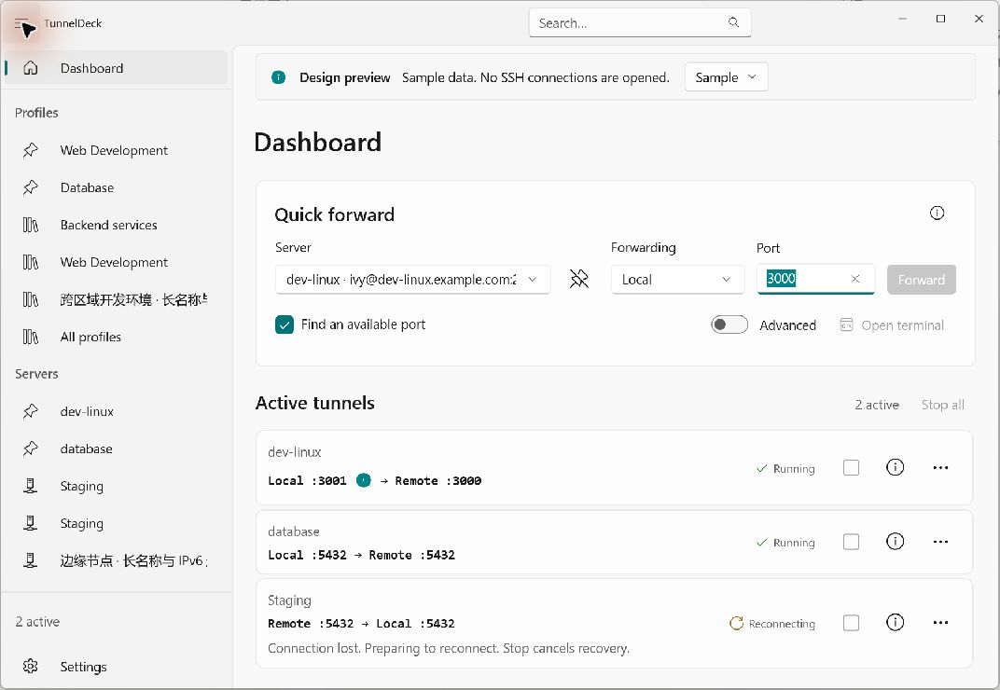
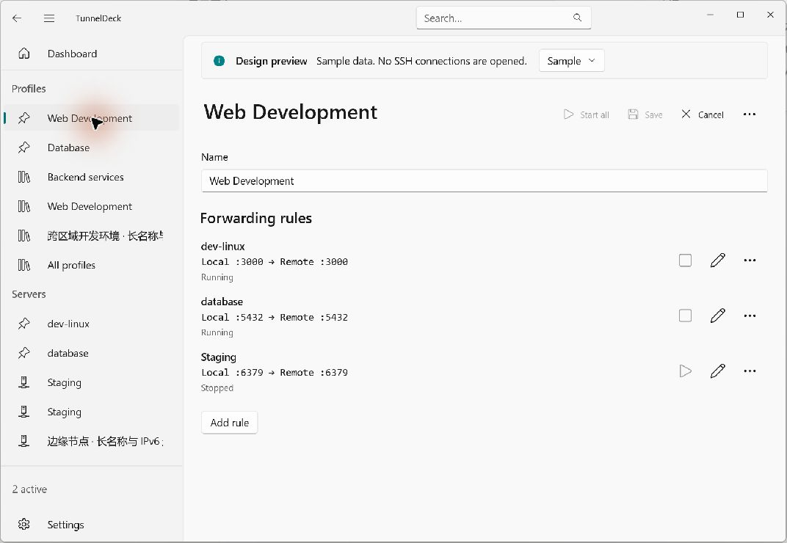

# TunnelDeck

[English](README.md) | 简体中文

一个面向 Windows 11 的现代 SSH 端口转发管理器，使用 WinUI 3 构建。将开发服务器、转发规则和活动隧道集中管理。

## 设计

**核心概念：**

- **服务器**：一个 SSH 连接，包含主机、端口、用户名以及密码或私钥认证。
- **规则**：通过服务器在两个端点之间进行的本地或远程端口转发。
- **配置组（Profile）**：一组可复用、可一起启动的规则，支持跨越多个服务器。
- **隧道**：规则的一个运行实例，拥有自己的状态和生命周期。

**功能：**

- 从仪表板快速进行本地和远程转发。
- 一起启动配置组；单独停止或重试隧道，并从临时断开中恢复。
- 自动查找可用的本地端口并显示实际的转发端点。
- 固定、重新排序和搜索服务器与配置组。
- 导入 SSH 配置文件；以 JSON 格式导入和导出服务器与配置组。
- 密码和私钥认证、主机密钥验证以及 Windows 凭据管理器集成。
- 最近活动、使用统计以及独立的 SSH 终端快捷方式。
- 浅色和深色主题、响应式布局，以及英语 / 简体中文即时语言切换。

## 项目

| 项目 | 用途 |
| --- | --- |
| [TunnelDeck](src/TunnelDeck) | WinUI 3 应用程序：页面、控件、导航和呈现。 |
| [TunnelDeck.Core](src/TunnelDeck.Core) | 领域模型、转发和配置组生命周期、配置策略以及本地化资源。 |
| [TunnelDeck.Infrastructure](src/TunnelDeck.Infrastructure) | SSH.NET 集成、JSON 持久化、Windows 凭据以及外部终端启动。 |

单元测试和集成测试位于 [tests/](tests)。测试自动化与隔离的 OpenSSH 夹具集中在 [scripts/](scripts/README.md)；需要编译的进程探针保留在 [test-infra/](test-infra)。

- [scripts/debug/](scripts/debug/README.md)：UI 回归、评测窗口、性能测量及共享调试辅助工具。
- [scripts/fixtures/](scripts/fixtures/README.md)：SSH 夹具启动 / 清理脚本及 Docker / Python 测试服务。
- [scripts/packaging/](scripts/packaging/README.md)：随发布包分发的运行库检查和 smoke 验证脚本。

## 构建和运行

该应用程序面向 **Windows x64** 和 **.NET 10**。在 Visual Studio 中打开 `TunnelDeck.slnx`，选择 **Release | x64**，然后构建应用程序。

有关环境设置、构建和启动命令、测试、Release 打包以及详细用法，请参阅[配置和用法](CONFIGURATION-zh.md)。可用脚本列在 [scripts/](scripts/README.md) 中。

## 屏幕截图

从应用程序的隔离设计预览中捕获，带有示例数据。显示的隧道为演示内容；不会打开任何 SSH 连接。

**仪表板 — 快速转发和隧道状态**

**配置组 — 包含多个转发规则的工作区**

## 依赖项

特别感谢这些开源项目：

| 项目 | 网站 |
| --- | --- |
| Windows App SDK / WinUI 3 | [microsoft/WindowsAppSDK](https://github.com/microsoft/WindowsAppSDK) |
| DevWinUI | [ghost1372/DevWinUI](https://github.com/ghost1372/DevWinUI) |
| SSH.NET | [sshnet/SSH.NET](https://github.com/sshnet/SSH.NET) |
