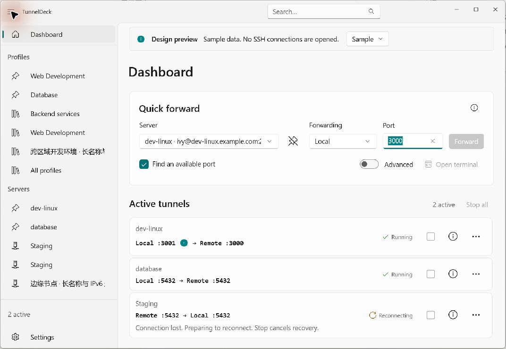
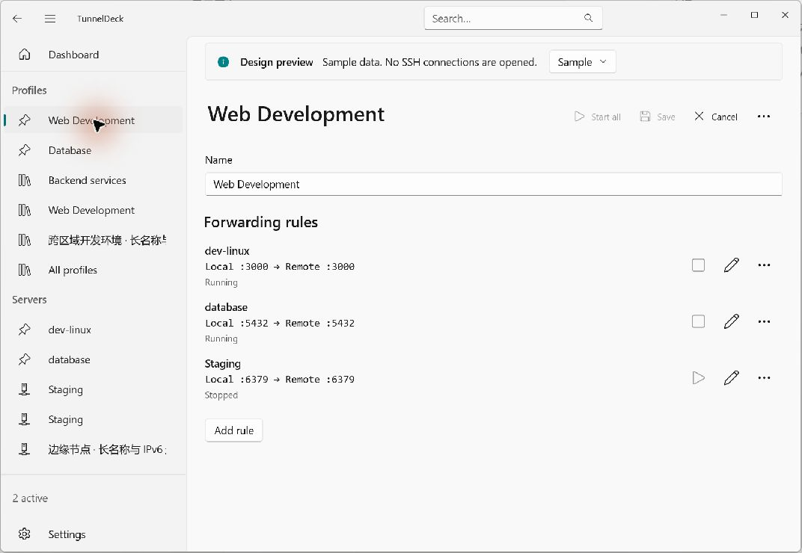

# TunnelDeck

English | [简体中文](README-zh.md)

A modern SSH port-forwarding manager for Windows 11, built with WinUI 3. Keep development servers, forwarding rules, and active tunnels in one place.

## Design

**Core concepts:**

- **Server**: An SSH connection with a host, port, username, and password or private-key authentication.
- **Rule**: A local or remote port forward between two endpoints through a server.
- **Profile**: A reusable group of rules, optionally spanning multiple servers, that you can start together.
- **Tunnel**: A running instance of a rule, with its own status and lifecycle.

**Features:**

- Quick local and remote forwarding from the dashboard.
- Start profiles together; stop or retry individual tunnels and recover from temporary disconnections.
- Automatically find an available local port and show the actual forwarding endpoints.
- Pin, reorder, and search servers and profiles.
- Import SSH config files; import and export servers and profiles as JSON.
- Password and private-key authentication, host-key verification, and Windows Credential Manager integration.
- Recent activity, usage statistics, and an independent SSH terminal shortcut.
- Light and dark themes, responsive layouts, and English / Simplified Chinese with instant language switching.

## Project

| Project | Purpose |
| --- | --- |
| [TunnelDeck](src/TunnelDeck) | WinUI 3 application: pages, controls, navigation, and presentation. |
| [TunnelDeck.Core](src/TunnelDeck.Core) | Domain models, forwarding and profile lifecycles, configuration policies, and localization resources. |
| [TunnelDeck.Infrastructure](src/TunnelDeck.Infrastructure) | SSH.NET integration, JSON persistence, Windows credentials, and external terminal launching. |

Unit and integration tests live in [tests/](tests). Test automation and the isolated OpenSSH fixture live in [scripts/](scripts/README.md); the compiled process probe lives in [test-infra/](test-infra).

- [scripts/debug/](scripts/debug/README.md): UI regression, preview windows, performance measurements, and shared debugging helpers.
- [scripts/fixtures/](scripts/fixtures/README.md): SSH fixture startup / cleanup scripts and the Docker / Python test service.
- [scripts/packaging/](scripts/packaging/README.md): prerequisite checks and smoke scripts distributed with release packages.

## Build and Run

The application targets **Windows x64** and **.NET 10**. Open `TunnelDeck.slnx` in Visual Studio, select **Release | x64**, and build the application.

See [Configuration and usage](CONFIGURATION.md) for environment setup, build and launch commands, testing, Release packaging, and detailed usage. Available scripts are listed in [scripts/](scripts/README.md).

## Screenshots

Captured from the application's isolated design preview with sample data. The displayed tunnels are demonstrations; no SSH connections are opened.

**Dashboard — quick forwarding and tunnel status**

**Profile — a workspace with multiple forwarding rules**

## Dependencies

Special thanks to these open-source projects:

| Project | Website |
| --- | --- |
| Windows App SDK / WinUI 3 | [microsoft/WindowsAppSDK](https://github.com/microsoft/WindowsAppSDK) |
| DevWinUI | [ghost1372/DevWinUI](https://github.com/ghost1372/DevWinUI) |
| SSH.NET | [sshnet/SSH.NET](https://github.com/sshnet/SSH.NET) |
